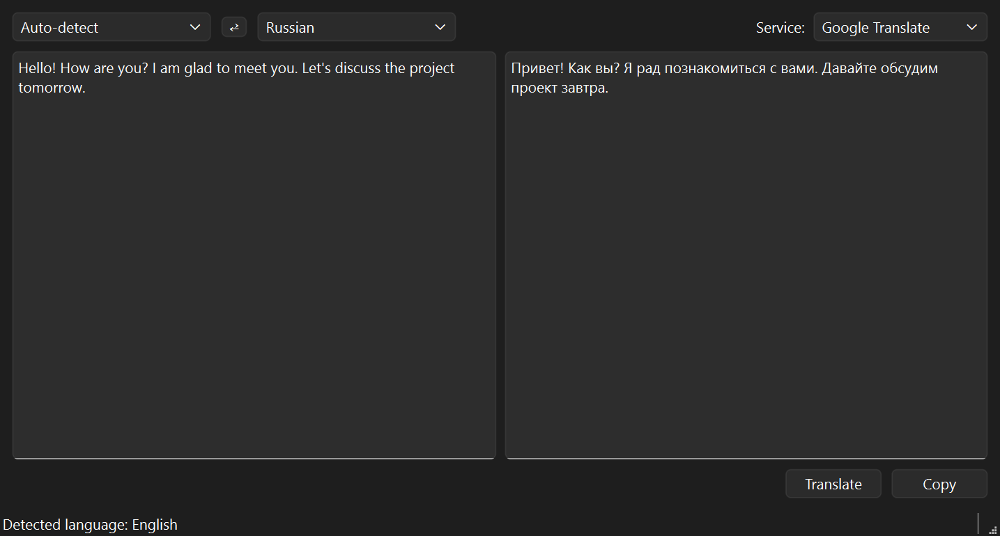
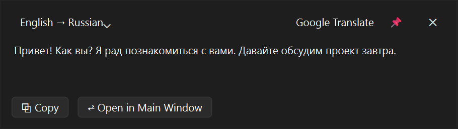
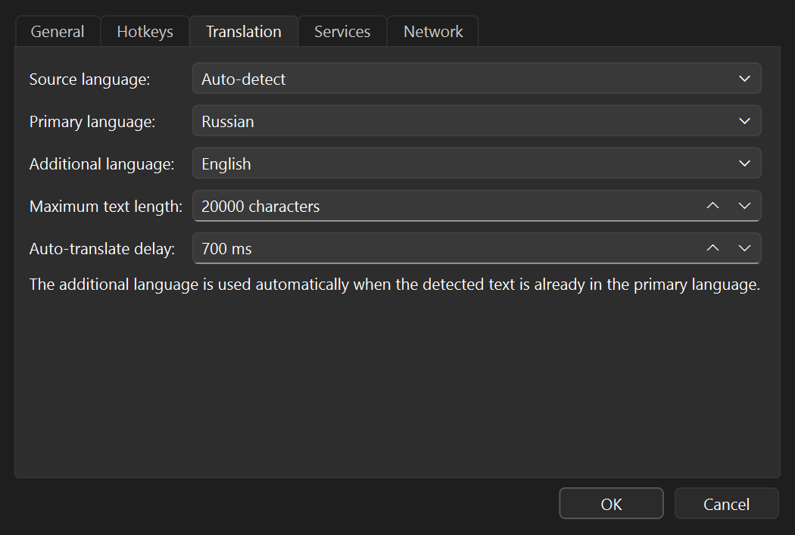
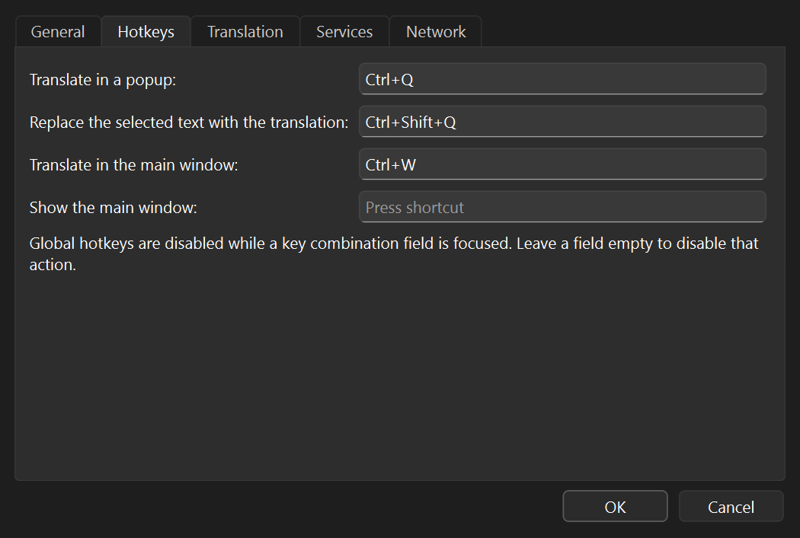

# qtranslate

[](https://github.com/youkaicat/qtranslate/actions/workflows/build.yml)

Fast and simple desktop translator for Windows. It lives in the system tray, translates the text
selected in any application with a global hotkey, and can replace the selection with the
translation directly in the active input field.

> **Status:** 0.9.0 release candidate. The Windows installer and the portable archive are
> available. Linux support is in development.

**English** | [Русский](README.ru.md)

## Screenshots

<p align="center">
  
</p>

<p align="center">
  
</p>

<p align="center">
  
  
</p>

## Main features

- **Popup translation — `Ctrl+Q`.** Select text in any application and get the translation in a
  small window next to the cursor. You can change the target language, copy the result, or open
  it in the main window.
- **Translate and replace — `Ctrl+Shift+Q`.** Select your reply in a chat, browser or editor; the
  translation replaces the selection in place. Nothing is pasted if you switch to another window
  while the request is in flight — the translation is copied to the clipboard instead.
- **Full translator window — `Ctrl+W`.** Opens with the selected text already translated, and
  works as a regular translator: source language auto-detection, language swap, copy, long-text
  splitting, translation cache and auto-translation while typing.
- **Google Translate and DeepL.** The free Google endpoint without a key, Google Cloud API with a
  key, and DeepL Free/Pro.
- **Proxy support.** The Windows system proxy or a manual HTTP/SOCKS5 proxy with optional
  authentication.
- **Tray and autostart.** Starts minimized in the tray, one instance per user, optional autostart
  with Windows. Closing the window hides it to the tray.
- **English and Russian UI**, portable mode with a local INI, and API keys/proxy passwords
  protected with Windows DPAPI.

## Download and install

The latest build is on the [Releases](https://github.com/youkaicat/qtranslate/releases/latest) page:

- **Installer** — `qtranslate-0.9.0-win64-setup.exe`. Installs qtranslate for the current user
  without administrator rights, creates Start menu and optional desktop shortcuts, and adds an
  uninstaller. Uninstalling keeps the settings in `%APPDATA%\qtranslate`.
- **Portable archive** — `qtranslate-0.9.0-win64.zip`. Extract it and run `bin\qtranslate.exe`;
  no installation or administrator rights are needed. The archive is self-contained: Qt and the
  MSVC runtime are included.
- **`SHA256SUMS.txt`** — SHA-256 checksums of both files.

The installer is not code-signed yet, so Windows SmartScreen may show a warning.

## Usage

```
qtranslate [--minimized] [--verbose]
```

- `Ctrl+Q` — translate the selection in a popup next to the cursor.
- `Ctrl+Shift+Q` — translate the selection and replace it in the active input field.
- `Ctrl+W` — open the main window with the selection translated.
- `Ctrl+Enter` — translate in the main window.
- Settings, service selection, **Show window** and **Quit** are available from the tray menu.
  Hotkeys, languages, proxy, autostart and API keys are configured in **Settings**.
- `--minimized` starts hidden in the tray; `--verbose` writes a detailed log to
  `%LOCALAPPDATA%\qtranslate\qtranslate.log`.
- Portable mode: put an empty `qtranslate.ini` next to `qtranslate.exe` and the application will
  use it instead of `%APPDATA%\qtranslate\qtranslate.ini`.

## Build

### Windows

Requirements:

- Windows 10/11, 64-bit
- Qt 6.5 or newer (developed with Qt 6.12) with the MSVC 2022 x64 kit
- CMake 3.19 or newer
- Visual Studio 2022 (MSVC)

Open `CMakeLists.txt` in Qt Creator, or build from an *x64 Native Tools Command Prompt*:

```bat
cmake -S . -B build/release -G Ninja -DCMAKE_BUILD_TYPE=Release -DCMAKE_PREFIX_PATH=C:/Qt/6.12.0/msvc2022_64
cmake --build build/release
ctest --test-dir build/release --output-on-failure
```

With CMake older than 3.22, the Qt `bin` directory must be in `PATH` for `ctest` to find the Qt
DLLs. Unit tests are built by default; pass `-DQTRANSLATE_BUILD_TESTS=OFF` to skip them.

To build the release artifacts (portable ZIP, per-user installer and `SHA256SUMS.txt`), install
[Inno Setup 6.3+](https://jrsoftware.org/isinfo.php) and run:

```powershell
./packaging/windows/package.ps1 -BuildDir build/release
```

The output goes to `build/artifacts`. The CI workflow
[`.github/workflows/build.yml`](.github/workflows/build.yml) runs the same steps on
`windows-latest` with Qt 6.8.3 LTS. Pushing a tag such as `v0.9.0` publishes a GitHub release with
these artifacts; the tag must match the version in `CMakeLists.txt`.

### Linux (in progress)

The Linux port is not finished yet. The core, network layer and Qt Widgets UI are designed to be
portable, but the platform modules are currently stubs: global hotkeys, selection capture, paste
into the active window and autostart are not implemented. A full Linux port is planned for a later
release; CI currently builds Windows only.

To build the current Linux tree for development:

```bash
cmake -S . -B build -G Ninja -DCMAKE_BUILD_TYPE=Release -DCMAKE_PREFIX_PATH=/path/to/Qt/6.8.3/gcc_64
cmake --build build
ctest --test-dir build --output-on-failure
```

## Known limitations

- Selection capture does not work in windows of processes started as administrator.
- The free Google endpoint can answer `HTTP 429` when it rate-limits a client; wait or use Google
  Cloud/DeepL with an API key.
- The intermediate `Ctrl+C` used to grab a selection may appear in the Windows clipboard history
  (`Win+V`); the original clipboard contents are restored.
- The installer is not code-signed yet.
- Linux support is not ready yet; see the build section above.

The text being translated is sent to the selected online service (Google or DeepL). qtranslate
does not write the texts to its log.
