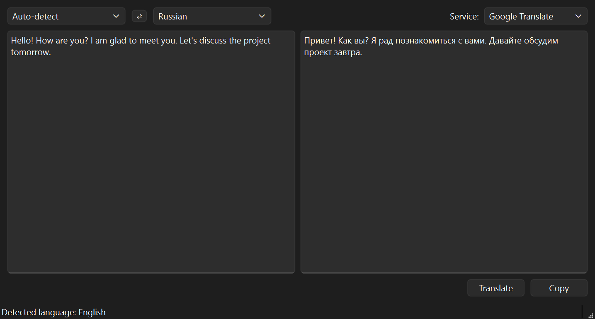
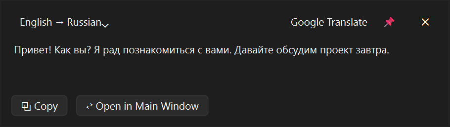
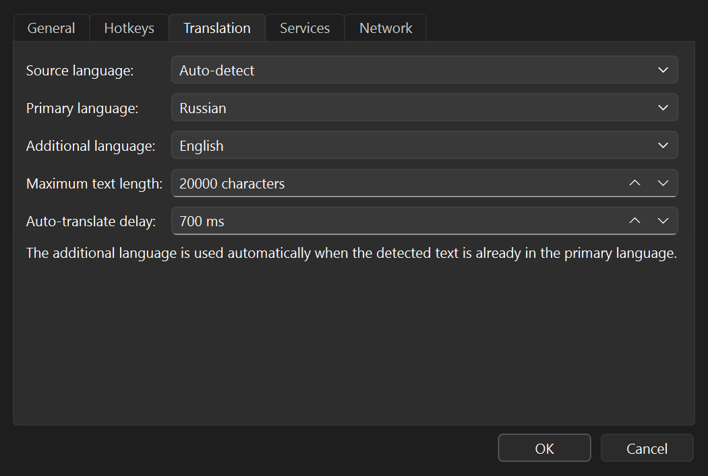
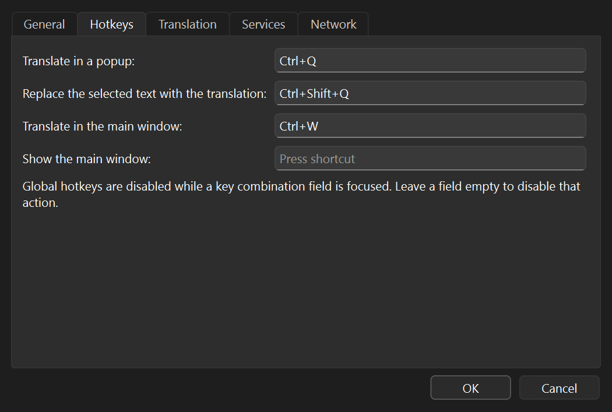

# qtranslate

[](https://github.com/youkaicat/qtranslate/actions/workflows/build.yml)

Быстрый и простой переводчик для Windows, живущий в системном трее.

> **Статус:** 0.9.0, release candidate. Доступны установщик для Windows и портативный ZIP.
> Поддержка Linux в разработке.

[English](README.md) | **Русский**

## Скриншоты

<p align="center">
  
</p>

<p align="center">
  
</p>

<p align="center">
  
  
</p>

## Основные возможности

- **Ctrl+Q** переводит выделенный текст в компактном окне рядом с курсором.
- **Ctrl+Shift+Q** переводит выделенный текст и заменяет им выделение в активном поле ввода —
  удобно для ответов в чатах.
- **Ctrl+W** открывает главное окно с переведённым выделением.
- Google Translate (бесплатный endpoint или Cloud API) и DeepL (Free/Pro).
- Автоопределение исходного языка, умное переключение на дополнительный язык, кэш переводов в
  памяти и автоперевод при наборе.
- Системный или ручной HTTP/SOCKS5-прокси с необязательной авторизацией.
- Русский и английский интерфейс, автозагрузка, портативный INI-режим, `--verbose`-логирование.

## Скачивание

- [Установщик для Windows](https://github.com/youkaicat/qtranslate/releases/download/v0.9.0/qtranslate-0.9.0-win64-setup.exe)
  — установка для текущего пользователя без прав администратора, ярлык в меню «Пуск» и
  деинсталлятор.
- [Портативный ZIP](https://github.com/youkaicat/qtranslate/releases/download/v0.9.0/qtranslate-0.9.0-win64.zip)
  — распакуйте и запустите `bin\qtranslate.exe`; установка не требуется.
- [Контрольные суммы SHA-256](https://github.com/youkaicat/qtranslate/releases/download/v0.9.0/SHA256SUMS.txt)

Настройки и горячие клавиши находятся в меню трея. Для портативного режима положите пустой
`qtranslate.ini` рядом с `qtranslate.exe`.

## Сборка

### Windows

Требуются Windows 10/11 x64, Qt 6.5 или новее, CMake 3.19 или новее и Visual Studio 2022.

```bat
cmake -S . -B build/release -G Ninja -DCMAKE_BUILD_TYPE=Release -DCMAKE_PREFIX_PATH=C:/Qt/6.12.0/msvc2022_64
cmake --build build/release
ctest --test-dir build/release --output-on-failure
```

Чтобы собрать портативный ZIP и установщик, установите [Inno Setup 6.3+](https://jrsoftware.org/isinfo.php)
и выполните:

```powershell
./packaging/windows/package.ps1 -BuildDir build/release
```

Результат — в `build/artifacts`. Workflow CI
[`.github/workflows/build.yml`](.github/workflows/build.yml) запускает те же шаги на
`windows-latest` с Qt 6.8.3 LTS.

### Linux (в разработке)

Порт под Linux пока не завершён. Ядро, сетевой слой и интерфейс на Qt Widgets спроектированы
переносимыми, но платформенные модули сейчас — заглушки: глобальные горячие клавиши, захват
выделения, вставка в активное окно и автозагрузка не реализованы.

```bash
cmake -S . -B build -G Ninja -DCMAKE_BUILD_TYPE=Release -DCMAKE_PREFIX_PATH=/path/to/Qt/6.8.3/gcc_64
cmake --build build
ctest --test-dir build --output-on-failure
```

Переводимый текст отправляется в выбранный онлайн-сервис (Google или DeepL). qtranslate не
записывает тексты в лог.
